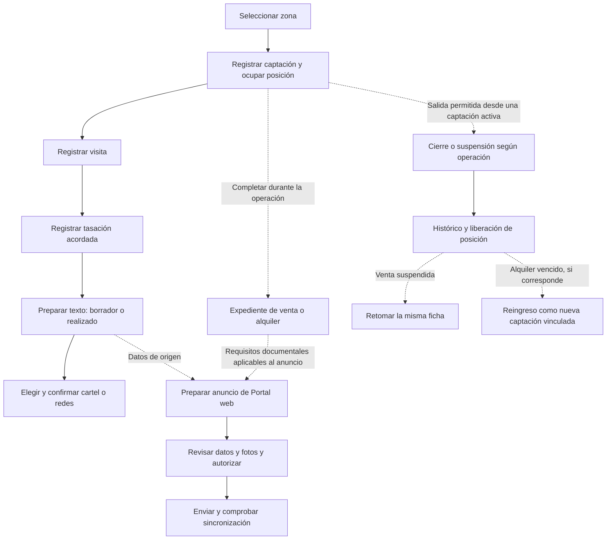

# Estudio del proceso inmobiliario para auditoría

Fecha: 25 de octubre de 2026. Base de código: `f05738d03aff33c4720c2a8029c38b2bae59d83f`.

## 1. Encargo y estado del estudio

Estudiar e interpretar el proceso de negocio implementado antes de emitir una evaluación sobre inconsistencias, orden, seguridad y controles. Este documento es la base de comprensión y el programa de revisión; **no es todavía un dictamen de auditoría ni una certificación de seguridad**. El usuario solicitó posteriormente una primera evaluación de inconsistencias; sus resultados por lectura de código se incorporan en la sección 11.

Esta sesión comprende lectura de código y documentación. No modifica reglas, datos, permisos ni configuración, no ejecuta pruebas sobre producción y no despliega cambios. Las validaciones de entregas anteriores se consideran antecedentes documentados, no pruebas nuevas de esta auditoría.

La referencia principal es el código de la revisión indicada. Los documentos históricos describen versiones anteriores y se contrastan con las entregas recientes; sus reglas no se trasladan automáticamente al proceso actual.

## 2. Interpretación general del negocio

El sistema administra captaciones inmobiliarias de venta y alquiler distribuidas por zonas. Cada captación ocupa una posición disponible y conserva una identidad interna independiente de esa posición. La posición puede reutilizarse después de una salida, mientras que la ficha y sus antecedentes tienen su propio ciclo de conservación.

El recorrido comercial habitual es captar, visitar, acordar valores, preparar texto, registrar difusión y atender la operación hasta su cierre o suspensión. La documentación se completa dentro del expediente. La publicación efectiva en el portal público tiene un circuito separado de revisión y envío.

La interpretación de trabajo distingue cinco planos:

- **Situación de la captación:** activa o histórica; una venta suspendida no equivale a una venta concluida.
- **Avance operativo:** visita, tasación, texto y confirmaciones de cartel/redes.
- **Expediente:** identificación, documentos, contratos y requisitos aplicables según venta o alquiler.
- **Exposición pública:** borrador, versión enviada, publicación, suspensión o retirada del anuncio web.
- **Acceso y trazabilidad:** quién consulta, modifica, confirma y deja evidencia de cada acción.

Ninguno de estos planos debe interpretarse como sustituto de los demás: una tarea marcada como realizada, un archivo cargado y una publicación web confirmada describen hechos diferentes.

## 3. Fases de navegación y etapas del negocio

| Organización visible | Contenido | Interpretación para el estudio |
| --- | --- | --- |
| FASE 1 del menú lateral | Panel, Cartera, Seguimiento, estadísticas y administración | Organización del trabajo operativo y de los accesos administrativos. |
| FASE 2 del menú lateral | Información de inmuebles | Consulta y gestión de ficha, documentos y fotos. |
| FASE 3 del menú lateral | Portal web: por publicar, activas y portada | Preparación y gestión de contenido público, incluida la portada general. |
| FASE 1 dentro de una ficha | Preparación: visitas/fotos, valores, texto y publicación | Carpetas y resumen de preparación del inmueble. |
| FASE 2 dentro de una ficha | Expediente documental de la operación | Carpetas y requisitos de venta o alquiler. |

Las fases del menú y las fases dentro de una ficha son niveles de organización distintos. Su numeración no demuestra que todas las acciones estén bloqueadas hasta completar la fase anterior. Para evaluar el orden se revisan las condiciones reales de cada API, no solo su posición en pantalla.

## 4. Mapa del recorrido habitual

El diagrama expresa el recorrido y sus ramificaciones; no impone pasos adicionales. La relación entre el cierre/suspensión de la ficha y el estado de sus anuncios debe contrastarse específicamente durante la auditoría.

## 5. Lectura por etapa

| Etapa | Entrada y actuación observadas | Resultado o evidencia | Fuentes principales |
| --- | --- | --- | --- |
| Zona y captación | Selección de zona, posición, operación, tipo, contacto y ubicación referencial; validación de disponibilidad dentro de transacción. | Inmueble activo, asignación de posición e historial. | `app/api/inmuebles/route.ts`, `lib/property-input.mjs`. |
| Visita | Registro de la visita inicial; la evidencia fotográfica tiene tratamiento propio y puede quedar pendiente conforme al flujo de visitas. | Visita completada y fotos vinculadas cuando existen. | `app/api/visitas/route.ts`, `lib/visit-photos.mjs`. |
| Tasación | Inmueble activo, posición activa y visita completada. Fecha no futura y no anterior a la visita; tres importes válidos. | Tasación registrada como aprobada e historial de registro/cambios. | `app/api/tasaciones/route.ts`, `lib/workflow-dates.mjs`. |
| Texto | Tasación aprobada e inmueble activo. Se distingue borrador de texto realizado. | Registro del texto, estado y fecha de realización. | `app/api/publicaciones/route.ts`, `lib/diffusion.mjs`. |
| Cartel y redes | Texto realizado antes de confirmar la difusión. Se eligen cartel, redes o ambos; los enlaces de referencia son opcionales. | Confirmaciones por medio, estado de publicación e historial. | `app/api/publicaciones/route.ts`, `lib/diffusion.mjs`. |
| Expediente | Documentos y condiciones aplicables a la operación; venta y alquiler tienen catálogos distintos. | Estado documental, requisitos pendientes, archivos y versión de configuración. | `lib/transaction-dossier.mjs`, API de expediente y archivos. |
| Portal web | Para anuncios nuevos de intranet se revisan actividad, tasación, documentos, fotos, texto, datos públicos, autorizaciones y versión de origen. | Borrador y versión pública diferenciados; estado de envío y confirmación remota. | `lib/portal-web-rules.mjs`, APIs y servicios de Portal web. |
| Salida | Administrador, zona seleccionada, inmueble activo y motivo compatible con venta/alquiler; importes y fechas según tipo de cierre. | Liberación de posición, histórico e historial en transacción. | `app/api/liberaciones/route.ts`, `lib/sale-result.mjs`, `lib/rental-result.mjs`. |
| Retorno y conservación | Venta suspendida: retorno de la misma ficha. Alquiler: circuito de contrato, renovación y reingreso con su propia identidad. Eliminación definitiva: circuito separado. | Antecedentes conservados o eliminación explícita según acción. | APIs de retomar, alquileres y eliminación; `lib/property-deletion.mjs`. |

### Tasaciones de venta y alquiler

Ambas operaciones muestran Tasación de Inmobiliaria, Precio de cierre aceptado por propietario y Precio de salida, con monedas PEN/USD. En alquiler los valores de oferta siguen siendo mensuales. El valor de tasación y el importe final del cierre representan registros distintos.

La consulta de Tasaciones negociadas registradas está separada del formulario de registro. Se limita a la zona elegida y conserva su buscador. La denominación visible no acredita por sí sola un procedimiento independiente de negociación o aprobación por otra persona.

### Documentación

Venta contempla identificación y poderes, documentos del inmueble, contratos, impuestos/constancias, servicios, cargas y archivos de tasación. Sus requisitos dependen de condiciones como persona natural/jurídica, propietarios, representación, comprador asignado y situación del impuesto.

Alquiler utiliza su catálogo de identificación, documentos del inmueble, contratos, servicios y tasaciones. La suficiencia de esos requisitos y su correspondencia con la práctica de la empresa se evaluarán por separado.

Los nombres vigentes incluyen Copia literal o CRI y HR y PU del año de la venta. Cargar un archivo en una categoría no equivale, por sí mismo, a una revisión de su contenido, autenticidad o vigencia.

### Difusión y Portal web

Registrar que se colocó un cartel o se difundió en redes es distinto de enviar un anuncio al portal. En la API actual de texto/difusión se revisan tasación, texto y confirmaciones; el portal tiene su propia lista de requisitos. No se debe utilizar una regla antigua de publicación como descripción automática de ambos circuitos.

Los anuncios anteriores cuyo origen es el propio portal tienen un tratamiento distinto de los anuncios nuevos procedentes de intranet. Sus requisitos y vinculación deben evaluarse respetando esa diferencia. Portada del sitio es contenido general, no un avance documental de un inmueble.

## 6. Roles y controles identificados para contrastar

| Aspecto | Comportamiento identificado | Límite de la observación |
| --- | --- | --- |
| Administrador | Acceso operativo, avance de preparación, Portal web y administración. | Comprobar después necesidad de separación de responsabilidades y aprobaciones. |
| Operador | Información de inmuebles y acciones documentales permitidas; sin acceso administrativo a la preparación de FASE 1 ni a Portal web. | Revisar cada acción de consulta, edición, carga, descarga y eliminación en servidor. |
| Sesiones | Cookie HttpOnly, SameSite=Lax y Secure en producción; token almacenado como hash; duración máxima y control de inactividad. | Lectura de código, no prueba de penetración ni comprobación de toda la configuración real. |
| Escrituras | Autorización en API y comprobación de origen en las solicitudes que pasan por el control común. | Es necesario revisar la cobertura de todos los puntos de entrada antes de concluir que es completa. |
| Segundo factor | Su exigencia depende de `AUTH_LOGIN_MFA_REQUIRED`. | No se ha consultado su valor efectivo en producción en este estudio. |
| Zona | Contexto de navegación y filtros de consulta/escritura según la API. | No equivale por sí sola a una autorización territorial por usuario. |
| Concurrencia | Transacciones, bloqueos y controles de versión en distintos registros. | Revisar qué objetos cubre cada mecanismo y qué ocurre ante cambios simultáneos. |
| Archivos | Metadatos relacionados con la ficha, categorías y acceso mediante API. | Quedan por revisar exhaustivamente almacenamiento, validación de contenido, descargas y conservación. |
| Historial | Registro de autor, fecha y detalle para diversas acciones de negocio. | No se presume cobertura completa, inmutabilidad ni reconstrucción integral de una operación. |
| Publicación web | Selección de datos públicos, revisión de fotos, autorizaciones, versiones y estado de sincronización. | Confirmar después exposición real, tratamiento de cambios, cierres, errores y anuncios anteriores. |
| Recuperación | Existen puntos de código y documentación de respaldos de entregas. | No se ha ensayado aquí una recuperación integral de base de datos, archivos y portal. |

## 7. Programa para la evaluación posterior

Al solicitarse las conclusiones, cada observación deberá distinguir un hecho comprobado, una inferencia y una cuestión pendiente de validación. Se examinarán:

1. **Orden y dependencias:** qué debe ocurrir antes de captar, tasar, difundir, publicar, contratar y cerrar; qué excepciones están permitidas y quién las autoriza.
2. **Representación del negocio:** diferencia entre contacto y titular, facultades de representación, varias partes, venta/alquiler, captación, negociación, acuerdo y cierre efectivo.
3. **Documentación y decisiones:** documentos que informan, documentos que bloquean, revisión de contenido/vigencia, responsable de revisión y tratamiento de faltantes o condiciones no aplicables.
4. **Consistencia de estados:** correspondencia entre Cartera, pendientes, ficha, expediente, publicaciones, Portal web, histórico y reportes.
5. **Importes y monedas:** tasación frente a oferta y cierre, moneda de cada importe, periodicidad mensual y comisión; comprobar que los totales no mezclen magnitudes distintas.
6. **Permisos y responsabilidad:** mínimo acceso necesario, alcance del operador, concentración de confirmaciones, doble revisión y tratamiento de cambios sensibles.
7. **Seguridad de la información:** datos personales, documentos privados, fotos autorizadas, enlaces, descargas, sesiones, credenciales, historial y acceso a servicios externos.
8. **Cambios posteriores:** efecto de cambiar precio, texto, fotos o documentos sobre lo publicado; efecto de suspender, cerrar o retomar una captación.
9. **Excepciones y concurrencia:** doble registro, posiciones ocupadas simultáneamente, confirmaciones repetidas, conflictos de versión y fallos parciales entre sistemas.
10. **Continuidad:** respaldo de código frente a respaldo de datos y archivos; recuperación coordinada, trazabilidad y conciliación con el portal público.
11. **Facilidad de operación:** claridad de nombres, distinción entre fases y tareas, búsquedas, zona seleccionada y prevención de errores por contexto.

Para cada posible hallazgo se preparará: escenario concreto, fuente, consecuencia, control existente, información pendiente, prioridad propuesta y alternativa de mejora. No se implementarán correcciones por el mero hecho de identificar un punto de revisión.

## 8. Validación operativa pendiente

Antes de afirmar cómo trabaja realmente la empresa conviene contrastar el modelo con sus responsables: encargo/autorización del propietario, revisión de titularidad y cargas, criterios de negociación, reserva/arras, firma, pagos, entrega, facturación/comisión y responsabilidades posteriores al cierre. Su presencia o ausencia en las pantallas revisadas no acredita por sí sola cómo se gestionan fuera del sistema.

Cualquier evaluación normativa posterior deberá identificar la jurisdicción y verificar fuentes oficiales vigentes. Este documento describe reglas de la aplicación; no establece que los requisitos documentales implementados satisfagan todas las obligaciones de una operación real.

## 9. Fuentes de referencia

Código revisado: navegación y Sidebar; registro e identidad de inmuebles; progreso de tareas; APIs de tasaciones, texto/publicación y liberación; reglas de expediente, difusión, Portal web, sesiones, autorización, alcance de zona y eliminación.

Documentación de apoyo, contrastada según fecha:

- [Última organización de listas, alquiler y FASE 3](datos-inmuebles-listas-alquiler-fase3-2026-10-25.md).
- [Submenú de tasaciones registradas por zona](tasaciones-submenu-2026-10-25.md).
- [Separación de tareas y contexto de zona](submenus-flujo-2026-10-24.md).
- [Registro simplificado](registro-simplificado-2026-10-15.md).
- [Expediente de la operación](expediente-operacion-2026-10-16.md).
- [Condiciones del vendedor natural](vendedor-persona-natural-2026-10-23.md).
- [Portal web](portal-web-fase4.md).
- [Ventas suspendidas y retorno](ventas-suspendidas-2026-10-19.md).
- [Mapa funcional histórico](mapa-funcional-revisado-2026-10-15.md), usado como antecedente, no como especificación vigente completa.

## 10. Próximo paso

La primera evaluación solicitada se registra a continuación. Las conclusiones distinguen comportamiento comprobado por lectura de código, consecuencias posibles y decisiones de negocio que requieren confirmación. No se han aplicado correcciones.

## 11. Primera evaluación solicitada: inconsistencias y riesgos de control

Base: código funcional de la revisión indicada, sin modificación de la aplicación. La prioridad es orientativa por impacto operativo, no una puntuación de vulnerabilidades. No se han comprobado incidentes reales, anuncios desactualizados concretos, contenido de expedientes ni configuración efectiva de producción.

### A1. Cierre interno y disponibilidad pública sin una transición coordinada — prioridad alta

**Hecho observado:** la API de liberaciones registra vendido, alquilado o venta suspendida, libera posición y cambia la ficha a inactiva. No ejecuta una acción de suspensión/retirada del Portal web. Esas acciones se gestionan por separado en el servicio del portal.

**Consecuencia posible:** un anuncio previamente enviado puede continuar disponible hasta que alguien actúe en Portal web. El código de cierre no garantiza su retirada. Esto no afirma que haya actualmente un anuncio concreto en esa situación.

**Mejora propuesta:** definir el tratamiento público de cada salida y vincularlo a una orden trazable de retirada/suspensión, con estado pendiente, reintento y aviso si falla. Los carteles y redes también necesitan una tarea de retirada o actualización cuando corresponda.

**Evidencia:** [API de liberaciones](../app/api/liberaciones/route.ts), [acciones del Portal web](../lib/portal-web.ts).

### A2. El avance visible no representa una aprobación documental uniforme — prioridad alta

**Hecho observado:** confirmar cartel/redes valida actividad, tasación y texto realizado, sin utilizar la comprobación documental como bloqueo. El cierre tampoco exige expediente completo. El portal sí exige determinados documentos y contenido para anuncios nuevos, pero no la totalidad del expediente de cierre.

**Interpretación:** los distintos canales tienen umbrales diferentes y las fases visibles no constituyen aprobaciones sucesivas. Permitir un cierre antes de publicar puede ser correcto; exigir todos los documentos finales antes de cualquier publicidad tampoco se deduce de este estudio.

**Consecuencia posible:** el usuario puede interpretar «publicación registrada», «FASE 2» o «cerrado» como una revisión que el sistema no ha realizado.

**Mejora propuesta:** acordar requisitos mínimos para ofrecer, publicar, formalizar y cerrar; distinguir cierre comercial de cierre documental y registrar expresamente las excepciones autorizadas. Evitar bloquear con documentos que solo pueden obtenerse en una etapa posterior.

**Evidencia:** [API de texto y difusión](../app/api/publicaciones/route.ts), [liberaciones](../app/api/liberaciones/route.ts), [requisitos del anuncio web](../lib/portal-web-rules.mjs).

### A3. Importes de tasación en dos monedas y cierre registrado en soles — prioridad alta

**Hecho observado:** las tasaciones conservan moneda por importe, PEN o USD. Los resultados de venta/alquiler no incorporan una moneda de cierre ni tipo de cambio, y el formulario/historial de liberación identifica sus importes en S/.

**Consecuencia posible:** si una operación acordada en USD se transcribe sin conversión, puede registrarse el mismo número como soles. Si se convierte manualmente, el cierre no deja constancia estructurada de la moneda original y conversión.

**Mejora propuesta:** definir moneda del importe final y de la comisión; si la empresa reporta todo en soles, conservar además importe original, moneda, tipo de cambio y fecha de conversión. No sumar soles y dólares como si fueran equivalentes.

**Evidencia:** [monedas y precios](../lib/prices.mjs), [resultado de venta](../lib/sale-result.mjs), [resultado de alquiler](../lib/rental-result.mjs), [registro e historial de cierre](../app/api/liberaciones/route.ts).

### A4. Poderes de alquiler siempre exigidos, sin condición de representación — prioridad media

**Hecho observado:** el catálogo de alquiler define poder obligatorio para arrendador y arrendatario; la función de aplicabilidad devuelve verdadero para todos los documentos de alquiler. No condiciona esos poderes a que la parte actúe mediante representante, mientras que venta sí contempla una condición de representación para ciertos documentos.

**Consecuencia posible:** un alquiler firmado personalmente puede quedar con pendientes que no corresponden al caso; los porcentajes pierden utilidad y el usuario podría cargar documentos solo para completar el indicador.

**Mejora propuesta:** definir por cada parte si firma personalmente o por representante y aplicar los documentos de representación según esa condición. Validar la regla con el responsable del expediente, sin inventar requisitos normativos.

**Evidencia:** `rentalDocuments` y `documentApplies` en [reglas del expediente](../lib/transaction-dossier.mjs).

### A5. Documento cargado y documento revisado comparten la misma señal de cumplimiento — prioridad media

**Hecho observado:** el estado documental determina cumplimiento por presencia de archivo alojado o, en supuestos concretos, nota admitida. Ese cálculo no acredita revisión humana del contenido, correspondencia con las partes, autenticidad o vigencia.

**Consecuencia posible:** «Completo» puede interpretarse como validación del expediente cuando significa que se recibió material en las categorías previstas.

**Mejora propuesta:** distinguir recibido, revisado, observado y validado; registrar responsable, fecha, observación y vencimiento cuando aplique. Mantener separado el progreso de carga del resultado de revisión.

**Evidencia:** `dossierStatus` en [reglas del expediente](../lib/transaction-dossier.mjs).

### A6. Tasación registrada como aprobada sin una aceptación diferenciada — decisión de negocio por confirmar

**Hecho observado:** el nuevo registro guarda directamente la situación aprobado y aparece como tasación negociada registrada. El formulario declara valores ya acordados; no existe en ese guardado una confirmación independiente del propietario o de un segundo responsable ni una evidencia obligatoria de aceptación vinculada al acuerdo.

**Interpretación:** puede ser una regla válida si el administrador carga únicamente acuerdos previamente aceptados fuera del sistema. El nombre del apartado y el estado aprobado, por sí solos, no demuestran esa aceptación.

**Mejora propuesta:** definir quién acepta los valores, cuándo y cómo queda la evidencia. Si se requiere control, registrar aceptación o referencia de sustento y distinguirla de la estimación inicial; no añadir una aprobación ficticia solo para crear otro paso.

**Evidencia:** [registro de tasaciones](../app/api/tasaciones/route.ts), [formulario de registro](../app/(privado)/(administracion)/registrar-tasaciones/RegistrationWorkspace.tsx).

### A7. La selección de zona no es una autorización por usuario — alcance de seguridad por confirmar

**Hecho observado:** el acceso de Información de inmuebles se concede por rol/sesión; la lista admite consultar todas las zonas y el filtro de zona no consulta una asignación de zona a usuario. El expediente se consulta por identidad del inmueble con el permiso general de información.

**Consecuencia posible:** si la empresa espera que un operador solo vea sus inmuebles o una zona asignada, el alcance de acceso actual no implementa esa expectativa. Si se decidió que todos los operadores consulten todas las zonas, se trata de un permiso amplio intencional, no de una intrusión demostrada.

**Mejora propuesta:** definir alcance por usuario/equipo/zona y aplicarlo en las consultas y archivos del servidor si el negocio lo requiere. La selección de una carpeta debe comunicarse como filtro de trabajo, no como garantía de confidencialidad territorial.

**Evidencia:** [autorización común](../lib/auth.ts), [filtro de zona](../lib/zone-scope.ts), [lista de inmuebles](../app/api/inmuebles/route.ts), [expediente por inmueble](../app/api/inmuebles/[id]/expediente/route.ts).

### Prioridad de revisión propuesta

Revisar primero A1, A2 y A3 con escenarios de venta, alquiler y suspensión. Después ajustar aplicabilidad y revisión documental (A4/A5) y acordar formalmente aceptación de precios y alcance de los operadores (A6/A7). Las correcciones deben preservar expedientes existentes y comprobar la compatibilidad con anuncios ya publicados.

Este informe no declara inexistentes los controles actuales: hay sesiones, validación de permisos en servidor, transacciones, controles de versión e historial. Los puntos anteriores señalan principalmente las transiciones y decisiones que esos mecanismos no resuelven por sí solos.

## 12. Reglas confirmadas por el usuario

El usuario respondió las seis consultas y autorizó las reglas de retiro voluntario del anuncio, moneda uniforme con conversión manual, documentos cargados obligatorios para cerrar, poderes condicionados en alquiler, operador con FASE 2 y FASE 3 completa y observación opcional del acuerdo. Su implementación y evidencia se registran en [Reglas acordadas de cierre, moneda y operador](reglas-proceso-cierre-moneda-operador-2026-10-25.md). Los hallazgos de la sección 11 describen la base anterior; no deben interpretarse como descripción automática de la versión posterior.
